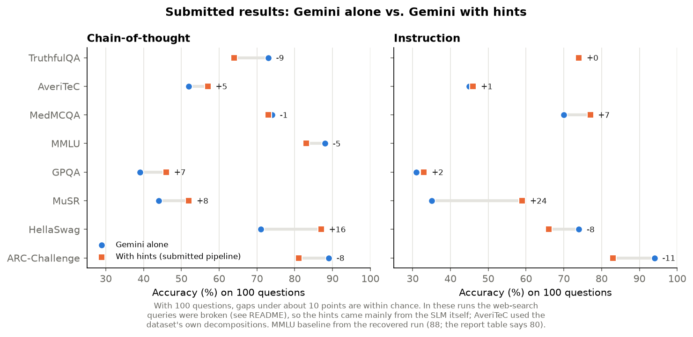

# Why-What-How RAG: a small local model guides retrieval for a large model

CS787 (Generative AI, IIT Kanpur) course project, Aug–Nov 2025, under Prof. Arnab Bhattacharya.
Team project (see [Team](#team)).

**Idea.** Large models still miss facts. Web search can supply them, but planning the
searches and reading the results with a big model costs tokens. Here a **small model
running locally (Llama-3.2-3B, 4-bit)** does that legwork, and the **large model
(Gemini)** is used only for the final answer.

```
question ──► SLM: split into WHY / WHAT / HOW search queries
          ──► web search (Serper), 2 snippets per query
          ──► SLM: turn the snippets into 4–8 short factual hints
          ──► Gemini: answer the question, with the hints  ──► A / B / C / D
```

Every question is answered in up to three ways ("arms"), so they are compared on the
same questions (a paired A/B test):

| Arm | What Gemini sees |
|---|---|
| `base` | the question only |
| `nosearch` | the question + hints the SLM writes from its own knowledge |
| `search` | the question + hints the SLM writes from the web snippets (the full pipeline) |

`search` vs `base` is the overall effect of the pipeline. `search` vs `nosearch` shows
what web retrieval adds on top of the SLM's own hints, i.e. when retrieval helps and
when it only adds noise. `analyze.py` reports each arm's accuracy, how many questions
only one arm got right, and an exact McNemar test.

## Benchmarks (8)
ARC-Challenge, HellaSwag, GPQA, MMLU, MedMCQA, MuSR, TruthfulQA (MC1) and AveriTeC.
All are loaded as multiple choice, with a fixed random sample of 100 questions each
(seed 42). AveriTeC becomes a choice between its four verdicts (Supported / Refuted /
Not Enough Evidence / Conflicting). MuSR and TruthfulQA have 2–10 options.

## Results

### Submitted results (the team's runs, Nov 2025)


Gemini alone vs. Gemini with hints, on the same 100 questions per benchmark, in two
prompting modes (there was no MMLU run in instruction mode). The effect varies a lot by
task. The largest gains are on MuSR (instruction, +24), where the recovered outputs show
the SLM pulling the key clues out of the long story, and HellaSwag (CoT, +16). The
largest losses are on ARC-Challenge (instruction, −11) and TruthfulQA
(CoT, −9), where Gemini already knows the answer and the extra context mostly adds noise.

In these runs the search queries were not read correctly from the SLM's reply, so the
gains come mainly from the SLM's hints rather than from web search; this version fixes
that. AveriTeC used the dataset's own claim decompositions as hints, and TruthfulQA was
scored by a Gemini judge. `results/submitted_report_numbers.csv` lists the source of
each number.

### This version of the code
Rebuilt from the team's notebooks with these changes:
- the SLM's queries are read from its newly generated text only (a unit test covers the
  old bug);
- the final letter is read from an explicit "Final Answer: X" line or a bare letter;
  anything else is counted as unparsed instead of being guessed;
- all 8 benchmarks go through the same multiple-choice pipeline (AveriTeC as four
  verdicts, TruthfulQA as MC1), with the SLM and web search used for every one;
- the `nosearch` arm, so a run can separate the effect of retrieval from the effect of
  the SLM's own hints.

`notebooks/kaggle_run.ipynb` runs all three arms on ARC-Challenge, HellaSwag and MuSR on
a free Kaggle T4 GPU; `python analyze.py` then writes `results/summary.csv`.

## How to run
Offline checks (no GPU, no keys):
```bash
python -m unittest -v          # parsing, the three arms with fake models, analysis, McNemar test
```
Full run, e.g. on a Kaggle GPU notebook (ready-made: `notebooks/kaggle_run.ipynb`):
```bash
pip install -r requirements.txt
export GEMINI_API_KEY=...  SERPER_API_KEY=...  HF_TOKEN=...   # HF token: Llama + gated GPQA
python run.py --bench musr --mode instruction --arms base,nosearch,search --n 100
python analyze.py                                       # -> results/summary.csv
```
With all three arms, 100 questions take about 300 Gemini calls and 300 searches.
`run.py` writes one JSON line per question (for each arm: queries, snippets with URLs,
hints, the raw reply and the prediction) and resumes where it stopped, which helps with
free-tier rate limits.

## Code
```
wwh_rag/benchmarks.py   load the 8 benchmarks as Item(question, options, gold, context)
wwh_rag/prompts.py      decomposition, hint (with / without snippets) and answer prompts
wwh_rag/models.py       LocalSLM (transformers, 4-bit), Gemini, SerperSearch
wwh_rag/parsing.py      read queries, hints and the final letter
wwh_rag/pipeline.py     the three arms: baseline(), why_what_how(), run_arms()
wwh_rag/stats.py        exact McNemar test
run.py  analyze.py  scripts/plot_submitted.py  tests/
```

## Next steps
- Rank and filter the search snippets before writing hints.
- Retrieve only when the large model is unsure, as the report suggests.

## Team
Akshat Saxena, Akshay Reddy, Om Chaudhari, Himesh Singh, Tattwa Shiwani.
The original team code is at
https://github.com/sorcererak/CS787-Project.
